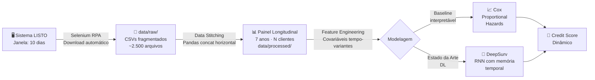

# 📊 Modelagem de Risco de Crédito Dinâmico para Microempreendedores
### Uma Abordagem via Análise de Sobrevivência em Fluxos de Alta Frequência

> **Trabalho de Conclusão de Curso (TCC)** · MBA em Ciência de Dados · ICMC/USP

<p align="center">
  
  
  
  
  
</p>

---

## 📋 Resumo Executivo

*Este projeto desenvolve um motor de **Credit Scoring Dinâmico** voltado ao segmento de microcrédito informal — historicamente excluído do sistema financeiro tradicional pela ausência de histórico bancário formal. A hipótese central sustenta que os **fluxos de caixa diários de alta frequência** constituem proxies robustas de solvência, capazes de superar em poder preditivo as variáveis socioeconômicas estáticas utilizadas pelos modelos convencionais de scoring. A abordagem metodológica fundamenta-se na **Análise de Sobrevivência**, modelando o tempo até o evento de inadimplência crítica (T ≥ 120 dias consecutivos de atraso) por meio do Modelo de Riesgos Proporcionais de Cox e arquiteturas de Deep Learning (DeepSurv/RNNs) para covariáveis variantes no tempo.*

---

## 🎯 Problema e Solução

### O Problema: Assimetria de Informação no Microcrédito

O mercado de crédito informal de alta frequência representa uma das maiores falhas estruturais do sistema financeiro latino-americano. Microempreendedores formais e informais, desprovidos de histórico de crédito bancário tradicional, são sistematicamente excluídos do sistema financeiro convencional. Consequentemente, são forçados a recorrer a fontes alternativas não regulamentadas, sujeitando-se a um custo de capital desproporcional e estruturação predatória que comprometem a sustentabilidade e escalabilidade de seus negócios.

### A Solução: *Revealed Preferences* como Sinal de Crédito

Em vez de depender de dados que esses empreendedores **não possuem** (histórico bancário, score Serasa/SPC), este trabalho explora o que eles **geram diariamente**: o registro transacional granular de suas operações de crédito. Os padrões de pagamento diários — atrasos, adiantamentos, consistência — revelam preferências e capacidade de pagamento de forma muito mais precisa do que variáveis estáticas.

<br>

| Dimensão | 🏦 Abordagem Tradicional | 🚀 Abordagem Proposta |
|---|---|---|
| **Dados de entrada** | Score estático, renda declarada | Fluxo de pagamentos diários (7 anos) |
| **Frequência de atualização** | Mensal / Anual | Diária (alta frequência) |
| **Cobertura populacional** | Bancarizados com histórico | Microempreendedores sub-bancarizados |
| **Modelo** | Regressão Logística / Score fixo | Cox PH + DeepSurv (tempo-variante) |
| **Variável alvo** | Binário: inadimplente / adimplente | T (dias de sobrevivência) + E (evento) |
| **Interpretabilidade** | Alta | Alta (Cox) + Média (DeepSurv) |

---

## 🏗️ Arquitetura do Projeto (MLOps / Cookiecutter Data Science)

```
tcc-mba-survival-analysis/
│
├── 📂 data/
│   ├── raw/                  # ⚠️  Ignorado pelo .gitignore (LGPD)
│   │   └── [CSVs_brutos_LISTO_*.csv]
│   └── processed/
│       ├── painel_longitudinal.parquet   # Produto do ETL / Data Stitching
│       └── matriz_covariáveis.parquet
│
├── 📓 notebooks/
│   ├── 01_EDA_exploratory.ipynb          # Análise Exploratória de Dados
│   ├── 02_kaplan_meier_curves.ipynb      # Curvas de Sobrevivência KM
│   └── 03_cox_model_baseline.ipynb       # Modelo de Cox — Baseline
│
├── 🐍 src/
│   ├── extractor/
│   │   └── selenium_bot.py              # RPA: download automatizado do LISTO
│   └── etl/
│       └── data_stitching.py            # Concatenação horizontal de CSVs
│
├── 🤖 models/
│   ├── cox_ph_baseline.pkl              # Modelo de Cox serializado
│   └── deepsurv_weights.pt             # Pesos da rede neural DeepSurv
│
├── .gitignore
├── requirements.txt
└── README.md
```

| Pasta | Propósito |
|---|---|
| `data/raw/` | CSVs transacionais brutos extraídos via RPA do sistema LISTO |
| `data/processed/` | Painel longitudinal limpo — produto do pipeline de Data Stitching |
| `notebooks/` | Análise exploratória, curvas de Kaplan-Meier e prototipagem de modelos |
| `src/` | Scripts de produção: bot Selenium e pipeline ETL |
| `models/` | Modelos serializados prontos para inferência |

---

## 🔬 Metodologia — Pipeline Analítico



### Definição Formal do Problema de Sobrevivência

| Notação | Definição |
|---|---|
| **T** | Variável aleatória: número de dias até o evento de inadimplência crítica |
| **E** | Indicador de evento: `1` se inadimplência ≥ 120 dias consecutivos, `0` se censurado |
| **S(t)** | Função de Sobrevivência: P(T > t) — probabilidade de permanecer adimplente além do dia t |
| **h(t)** | Função de Risco (*Hazard*): taxa instantânea de falha no instante t |
| **120 dias** | Limiar empírico de não-retorno — definido com base em análise de recuperação histórica |

### Modelos Implementados

**1. Baseline — Modelo de Riesgos Proporcionais de Cox (Cox PH)**
- Estimação semi-paramétrica sem pressuposto distribucional para S(t)
- Permite quantificação do efeito de cada covariável via *Hazard Ratio* (HR)
- Alta interpretabilidade para audiência de negócios e reguladores

**2. Estado da Arte — DeepSurv & RNN**
- Rede neural profunda que aprende a função de risco a partir de sequências temporais
- Captura dependências não-lineares e interações entre covariáveis variantes no tempo
- Validação via *concordance index* (C-index) e comparação com o baseline de Cox

---

## ⚙️ Stack Tecnológico

| Categoria | Tecnologia | Finalidade |
|---|---|---|
| **Linguagem** | Python 3.12 | Core do projeto |
| **Análise de Sobrevivência** | `lifelines` | Cox PH, Kaplan-Meier, Nelson-Aalen |
| **Deep Learning** | `torch` / DeepSurv | Modelagem neural de risco |
| **ETL & Manipulação** | `pandas`, `numpy` | Data Stitching e feature engineering |
| **Web Scraping / RPA** | `selenium` | Download automatizado do LISTO |
| **Visualização** | `matplotlib`, `seaborn` | Curvas KM, EDA, diagnóstico de modelos |
| **ML Clássico** | `scikit-learn` | Pré-processamento, validação cruzada |
| **Ambiente** | `venv` | Isolamento de dependências |
| **Versionamento** | `git` + GitHub | Controle de versões e colaboração |

---

## 🚀 Instalação e Execução

```bash
# 1. Clone o repositório
git clone git@github.com:graciano90210/tcc-mba-survival-analysis.git
cd tcc-mba-survival-analysis

# 2. Ative o ambiente virtual
source venv/bin/activate

# 3. Instale as dependências
pip install -r requirements.txt

# 4. (Opcional) Execute o bot de extração
python src/extractor/selenium_bot.py

# 5. Inicie o Jupyter para análise exploratória
jupyter notebook notebooks/
```

> **Pré-requisito:** Python 3.12+ instalado no sistema. O ChromeDriver compatível com o Google Chrome instalado é necessário para execução do bot Selenium.

---

## 📁 Dados e Conformidade com a LGPD

Os dados transacionais brutos contidos em `data/raw/` são **omitidos do versionamento** via `.gitignore` em conformidade com a **Lei Geral de Proteção de Dados Pessoais (LGPD — Lei nº 13.709/2018)**. Os datasets contêm informações financeiras individuais de microempreendedores, classificadas como dados sensíveis. Somente dados agregados e anonimizados presentes em `data/processed/` podem ser compartilhados com terceiros mediante autorização institucional.

---

## 👤 Autoria e Orientação Acadêmica

<table>
  <tr>
    <td align="center" width="50%">
      <strong>Autor</strong><br><br>
      <strong>Juan Fernando Graciano Pinzon</strong><br>
      MBA em Ciência de Dados<br>
      ICMC · Universidade de São Paulo (USP)<br>
      <a href="https://github.com/graciano90210">@graciano90210</a>
    </td>
    <td align="center" width="50%">
      <strong>Orientador</strong><br><br>
      <strong>Prof. Dr. Vicente Garibay Cancho</strong><br>
      Especialista em Inferência Bayesiana<br>
      e Análise de Sobrevivência<br>
      ICMC · Universidade de São Paulo (USP)
    </td>
  </tr>
</table>

---

## 📚 Referências Metodológicas Principais

- **Cox, D. R.** (1972). Regression models and life-tables. *Journal of the Royal Statistical Society: Series B*, 34(2), 187–202.
- **Kalbfleisch, J. D. & Prentice, R. L.** (2002). *The Statistical Analysis of Failure Time Data* (2nd ed.). Wiley.
- **Kvamme, H., Borgan, Ø., & Scheel, I.** (2019). Time-to-event prediction with neural networks and Cox regression. *Journal of Machine Learning Research*, 20(129), 1–30.
- **Davidson-Pilon, C.** (2019). *lifelines: survival analysis in Python*. Journal of Open Source Software, 4(40), 1317.
- **Kim, Jong-Min (Deep Learning em Análise de Sobrevivência):** Literatura seminal recomendada pela orientação (Prof. Dr. Vicente Garibay Cancho) que fundamenta matematicamente a transição dos modelos clássicos de riscos proporcionais para arquiteturas de Redes Neurais baseadas em cópulas e funções de perda adaptadas à censura.

---

<p align="center">
  <sub>Desenvolvido com rigor acadêmico e boas práticas de MLOps · ICMC/USP · 2025–2026</sub><br>
  <sub>Licença MIT · Os dados brutos são propriedade da instituição financeira parceira e estão protegidos pela LGPD</sub>
</p>
